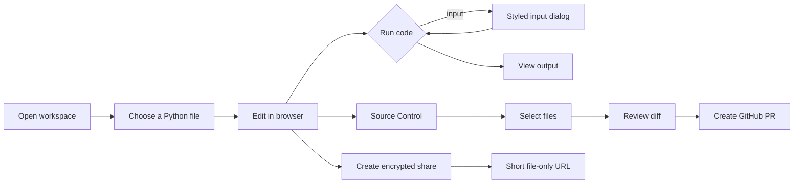

# ⚡ Python Playground

> A fast, browser-first Python workspace for learning, experimenting, and shipping changes through GitHub.

[](https://www.python.org/)
[](https://fastapi.tiangolo.com/)
[](./test_app.py)
[](#development)

```text
  ┌──────────────────────────────────────────────────────────────┐
  │  $ python-playground                                        │
  │  > edit  →  run  →  review  →  share  →  open a PR         │
  │  > status: ● online                                         │
  └──────────────────────────────────────────────────────────────┘
```

### Development URLs

| Service | URL |
|---|---|
| Local app | http://127.0.0.1:8000 |
| Local API docs | http://127.0.0.1:8000/docs |
| Hosted frontend | https://pravin22kumar.github.io/Python/ |
| Hosted API | https://python-playground-api.onrender.com |

The hosted URLs depend on the GitHub Pages and Render deployments being active.

A browser-based Python workspace built with FastAPI. It loads Python files from GitHub, runs code in an isolated subprocess, provides editor tools, and can create pull requests from workspace changes.

## Features

- Python editor with tabs, file explorer, search, themes, syntax highlighting, formatting, and linting.
- Execution controls for stdin, timeout, memory, network blocking, `unittest`, `pytest`, and allowlisted packages.
- Workspace persistence and online/offline API status.
- Compact encrypted share links for one selected file.
- Source Control panel with colored added/modified/renamed/deleted changes, file selection, exclusion, and diff preview.
- Contributor IDs in the format `#name@12345`.
- Duplicate contributor and phone-number checks.
- Administrator user management.
- GitHub pull-request creation.

## How it works



## Interface tour

```text
┌─ Explorer ─────┬─ Editor ───────────────────────────────┐
│ hello.py       │ 1  name = input("Name: ")              │
│ operators.py   │ 2  print(name)                          │
│ input.py       │                                         │
├────────────────┴─────────────────────────────────────────┤
│ Output  ● Completed successfully                         │
└───────────────────────────────────────────────────────────┘
```

Use **Settings** for execution controls, editor tools, Source Control, and administrator actions. The toolbar keeps Run, Download, Save as PR, theme, and API status visible.

## Development

This project is actively evolving. Run the test suite before submitting changes and keep credentials out of source control.

## Requirements

- Python 3.11 or newer
- A GitHub repository for file loading and pull requests

## Local setup

```bash
cd /Users/pravinkumar/Desktop/Python
python3 -m venv .venv
source .venv/bin/activate
pip install -r requirements.txt
uvicorn app:app --reload --host 127.0.0.1 --port 8000
```

Open http://127.0.0.1:8000.

Run tests:

```bash
pytest -q
```

## Configuration

Public files can be loaded without a token. A GitHub token is required for pull requests:

```bash
export GITHUB_TOKEN="your_github_token"
export GITHUB_OWNER="pravin22kumar"
export GITHUB_REPO="Python"
export SHARE_SECRET="a-long-random-secret"
export ALLOWED_PACKAGES="numpy,pandas"
```

For fine-grained GitHub tokens, enable **Contents: Read and write** and **Pull requests: Read and write**. Never commit tokens or place them in frontend code.

## Contributor IDs

On first use, enter an existing ID or create one with a name and phone number. The format is:

```text
#name@last-five-phone-digits
```

The current administrator ID is `#pravin@89190`. Contributor records are stored in `shares.db`; phone numbers are stored as SHA-256 hashes. The administrator can manage users from **Settings → Manage users**.

## Sharing a file

Select a file and choose **Settings → Share**. The encrypted file is stored in the local share database and the URL contains only a short ID:

```text
http://127.0.0.1:8000/#share=short-id
```

Opening the link loads only that shared file. Use a stable `SHARE_SECRET` in deployments so links remain readable after restarts.

## Running code with input

For code using `input()`, click **Run Python**. The application displays a styled input dialog for every input call and sends the collected values to the isolated process. Execution settings are under **Settings → Execution**.

## Pull requests

1. Edit or add Python files.
2. Open **Settings → Source control**.
3. Select files to include or exclude files with `×`.
4. Click **Save as PR** and review the diff preview.
5. Confirm creation.

The contributor ID is included in the pull-request title and description. The backend creates a temporary branch, applies selected changes, and opens a pull request against the configured base branch.

## API endpoints

| Method | Endpoint | Purpose |
|---|---|---|
| GET | `/api/health` | API availability |
| GET | `/api/files` | List repository Python files |
| GET | `/api/files/check` | Check a filename |
| POST | `/api/run` | Execute Python code |
| POST | `/api/lint` | Validate syntax |
| POST | `/api/format` | Format Python code |
| POST | `/api/save` | Create a GitHub pull request |
| POST | `/api/source-control/preview` | Validate changes |
| POST | `/api/share` | Create an encrypted share ID |
| GET | `/api/share/{id}` | Restore a shared file |
| POST | `/api/users/register` | Register a contributor |
| GET | `/api/users/check/{id}` | Check contributor status |
| GET | `/api/admin/users` | List users as admin |
| PUT | `/api/admin/users/{id}` | Edit a user as admin |
| DELETE | `/api/admin/users/{id}` | Delete a user as admin |

## Security notes

- `shares.db` is local application data and is ignored by Git.
- Keep `GITHUB_TOKEN` and `SHARE_SECRET` in environment variables.
- Code execution has network access disabled by default.
- Packages must be listed in `ALLOWED_PACKAGES` before use.
- Production deployments should replace the default administrator configuration with real authentication and authorization.

## Docker

```bash
docker build -t python-playground .
docker run --rm -p 8000:8000 \
  -e GITHUB_TOKEN="$GITHUB_TOKEN" \
  -e SHARE_SECRET="$SHARE_SECRET" \
  python-playground
```
